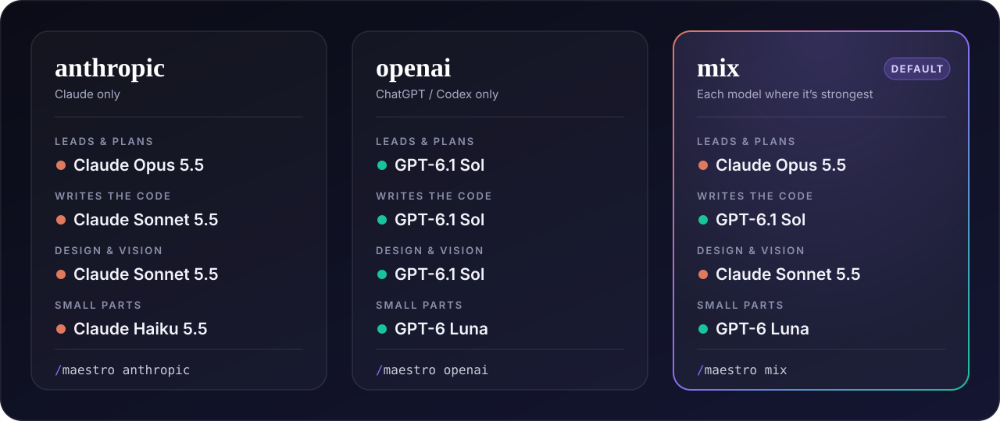
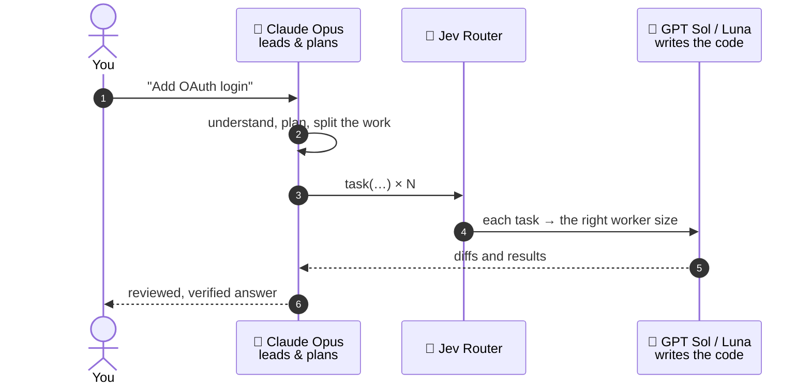
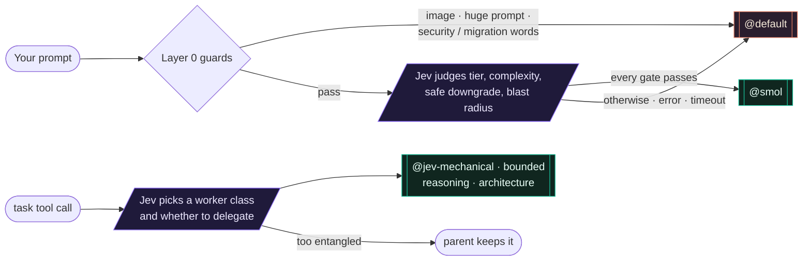

<p align="center">
  
</p>

<p align="center">
  <a href="https://www.npmjs.com/package/omp-maestro"></a>
  <a href="https://github.com/can1357/oh-my-pi"></a>
  
  
  <a href="./LICENSE"></a>
</p>

<p align="center">
  <b>The omp setup I use every day — curated public plugins &amp; skills, my own Jev Router,<br>and three model ensembles you can switch with a single command.</b>
</p>

<p align="center">
  <a href="#-quick-start">Quick start</a>&nbsp;&nbsp;·&nbsp;&nbsp;<a href="#-three-ensembles">Ensembles</a>&nbsp;&nbsp;·&nbsp;&nbsp;<a href="#-jev-router">Jev Router</a>&nbsp;&nbsp;·&nbsp;&nbsp;<a href="#%EF%B8%8F-commands">Commands</a>&nbsp;&nbsp;·&nbsp;&nbsp;<a href="#-faq">FAQ</a>&nbsp;&nbsp;·&nbsp;&nbsp;<a href="#-credits">Credits</a>
</p>

<br>

```sh
npx omp-maestro
```

<br>

> [!NOTE]
> **Maestro is mostly other people's work.** It is a collection of public plugins and skills I use in my own harness, packaged together with the one piece I wrote — the **Jev Router** — so you can try the whole setup in one go. Every plugin and skill is installed from its original source, and every author is credited [below](#-credits). Go star their repos. ⭐

<br>

<table>
  <tr>
    <td width="33%" valign="top">
      <h3>🎼 One command</h3>
      Plugins, skills, model roles and fallback chains — installed and wired up by a single <code>npx</code>. Pick the skill libraries you want from an arrow-key checklist.
    </td>
    <td width="33%" valign="top">
      <h3>🎻 Three ensembles</h3>
      Claude only, ChatGPT only, or a <b>mix</b> where a thinker model leads and a coder model writes the code. Switch any time with <code>/maestro</code>.
    </td>
    <td width="33%" valign="top">
      <h3>🧭 Jev Router</h3>
      Every prompt and every subagent is judged by <a href="https://typesafe.ai">TypeSafe Jev</a> and sent to the smallest model that can do it well. Fails open, never down.
    </td>
  </tr>
</table>

<br>

## 🚀 Quick start

**You need** [omp](https://github.com/can1357/oh-my-pi), Node.js (for `npx`) or Bun (for `bunx`), and `git`.

```sh
npx omp-maestro              # 🎼 mix — Claude leads, GPT codes  (default)
npx omp-maestro anthropic    # 🟠 Claude only
npx omp-maestro openai       # 🟢 ChatGPT / Codex only

bunx omp-maestro mix         # same thing, with bun
```

The installer asks one question up front — which skill libraries you want — then runs unattended:

```text
🎼 Skill libraries (installed into ~/.agents/skills)
   ↑/↓ move · space select/deselect · enter confirm

❯ ◉ coderabbitai/skills (2) — CodeRabbit code review and auto-fixing of PR review comments
  ◉ vercel-labs/skills (1) — find-skills: search and install more skills when you need a new capability
  ◯ expo/skills (25) — Expo / React Native apps: routing, native UI, modules, EAS builds, updates and store releases
  ◉ heygen-com/hyperframes (7) — HyperFrames: make videos, slideshows and motion graphics from HTML, plus Figma import
  ◯ sanity-io/agent-toolkit (2) — Sanity CMS: schema/GROQ best practices and migrating content into Sanity
  ◉ emilkowalski/skills (15) — Emil Kowalski's design engineering: UI polish, web/Expo animation, Apple-style design, Swift
```

Then, inside omp:

1. **Log in** to the providers your ensemble uses — `/login` → Anthropic and/or OpenAI Codex (ChatGPT plan).
2. **Give the router a key** — `export TYPESAFE_API_KEY=…` or add `TYPESAFE_API_KEY=…` to `~/.omp/agent/.env`.
3. **Play.** The status line shows 🧭 `jev: ON` when the router is live.

> [!TIP]
> Re-running the installer is safe. It updates everything and re-applies the ensemble you name — handy on a new machine.

<br>

## 🎻 Three ensembles

<p align="center">
  
</p>

Switch inside omp at any time — the live session moves to the new lead model immediately:

```text
/maestro              show the active ensemble and the choices
/maestro mix          Claude leads, GPT codes, Sonnet designs
/maestro anthropic    all Claude
/maestro openai       all ChatGPT / Codex
```

Only the roles an ensemble defines are rewritten; any other roles you've set stay untouched. Every role also gets a **fallback chain** — single-provider ensembles fall back within that provider, the mix falls back *across* providers, so hitting a usage limit on one plan doesn't stop the music.

<details>
<summary><b>Every role, every ensemble</b></summary>
<br>

| Role | `anthropic` | `openai` | `mix` |
| --- | --- | --- | --- |
| `default` — main agent, the lead | Claude Opus 5.5 · medium | GPT-6.1 Sol · medium | **Claude Opus 5.5** · medium |
| `plan`, `slow` | Claude Opus 5.5 · high | GPT-6.1 Sol · high | Claude Opus 5.5 · high |
| `task` — default subagent, writes code | Claude Sonnet 5.5 | GPT-6.1 Sol | **GPT-6.1 Sol** |
| `designer`, `vision` | Claude Sonnet 5.5 | GPT-6.1 Sol | Claude Sonnet 5.5 |
| `smol`, `tiny`, `memory`, `commit` | Claude Haiku 5.5 · low | GPT-6 Luna · low | GPT-6 Luna · low |
| `jev-mechanical` | Claude Haiku 5.5 · low | GPT-6 Luna · low | GPT-6 Luna · low |
| `jev-bounded` | Claude Haiku 5.5 · medium | GPT-6 Luna · medium | GPT-6 Luna · medium |
| `jev-reasoning` | Claude Sonnet 5.5 | GPT-6.1 Sol | GPT-6.1 Sol |
| `jev-architecture` | Claude Opus 5.5 · high | GPT-6.1 Sol · high | GPT-6.1 Sol · high |
| `judge` | TypeSafe Jev | TypeSafe Jev | TypeSafe Jev |
| `web` | Exa → DuckDuckGo | Exa → DuckDuckGo | Exa → DuckDuckGo |

Fallback chains for every role live in [`profiles.json`](./profiles.json).

</details>

### How the mix plays



The **thinker** reads the request, plans, splits the work and reviews what comes back. The **coders** do the implementation as subagents. Want the lead to *never* touch code itself? Turn on omp's built-in **`/vibe`** director mode: the main model only reads and directs, `fast` workers run on `@smol` and `good` workers on `@task` — in the mix that's exactly Opus conducting GPT.

<br>

## 🧭 Jev Router

> *The one part of Maestro I wrote.* An omp extension that asks [TypeSafe Jev](https://typesafe.ai) how much model each piece of work actually needs — before any tokens are spent on it.



| | |
| --- | --- |
| **Main turns** | Before each prompt runs, Jev judges it. Only when *every* conservative gate passes — economy tier with high confidence, low complexity, safe to downgrade, low blast radius — does the turn run on `@smol`. Afterwards the session returns to `@default`. A model you picked by hand is left alone. |
| **Subagents** | Every proposed `task` is classified `mechanical`, `bounded`, `reasoning` or `architecture` and spawned on the matching `jev-*` role, with that role's fallback chain. Risky *changes* — auth, migrations, payments, concurrency — are floored to `architecture`. Work that depends on the parent's unfinished reasoning stays in the parent. |
| **Fails open** | No key, a 1.8 s timeout, or any Jev error means plain omp behaviour. You never get a weaker model because the router hiccuped. |

<details>
<summary><b>Tuning the router</b></summary>
<br>

All thresholds live in the `CONFIG` block at the top of [`extensions/jev-router.ts`](./extensions/jev-router.ts):

| Setting | Default | Meaning |
| --- | --- | --- |
| `timeoutMs` | `1800` | Give up on Jev after this long and stay on `@default` |
| `maxPromptChars` | `12000` | Longer prompts skip Jev and stay on `@default` |
| `economyChoiceConfidenceMin` | `0.88` | Confidence needed in the "economy" tier |
| `safeDowngradeMin` | `0.90` | Confidence that a weaker model is safe |
| `complexityMaxForSmol` | `1.25` | Highest complexity score (0–4) allowed on `@smol` |
| `highImpactMaxForSmol` | `0.15` | Highest blast-radius probability allowed on `@smol` |
| `subagentClassConfidenceMin` | `0.65` | Below this, a subagent goes to `reasoning` |
| `subagentDelegateMin` | `0.30` | Below this, the work stays in the parent |

</details>

<br>

## ⌨️ Commands

| Command | What it does |
| --- | --- |
| `/maestro` | Show the active ensemble and the choices |
| `/maestro mix` · `anthropic` · `openai` | Switch ensemble; the live session follows |
| `/jev-route status` | Router counters and the last decision |
| `/jev-route on` · `off` | Turn routing on or off for this session |
| `/jev-route verbose` · `quiet` | Show or hide each routing decision |
| `/jev-route test <prompt>` | Dry-run the main-turn router |
| `/jev-route test-task <task>` | Dry-run the subagent classifier |
| `/vibe` | omp's director mode — the lead only directs workers |
| `/ponytail` | Lazy-senior-dev mode from [ponytail](https://github.com/DietrichGebert/ponytail) |

<br>

## 📦 What gets installed

| | Piece | Source | What it adds |
| :-: | --- | --- | --- |
| 🎼 | **omp-maestro** | this repo | Jev Router, `/maestro`, the `smart-commit` agent |
| 🐴 | **ponytail** | [DietrichGebert/ponytail](https://github.com/DietrichGebert/ponytail) | "Lazy senior dev" mode — the smallest complete change |
| 🧰 | **up to 52 skills** | [`skills.json`](./skills.json), via the [`skills`](https://github.com/vercel-labs/skills) CLI | the libraries you tick in the checklist |
| 🎚️ | **model roles + fallbacks** | [`profiles.json`](./profiles.json) | written to your omp `config.yml` — only the roles listed |

Skills come straight from their authors' repositories, so you always get the current versions. A library that fails to install is skipped with a warning; everything else carries on.

<br>

## 🛠️ Make it yours

- **Change any role** with omp's `/model` (Roles view). `/maestro` shows `custom` once your roles no longer match an ensemble exactly.
- **Ship your own ensembles** — fork, edit [`profiles.json`](./profiles.json). The command, the installer and the router all read it; nothing else changes.
- **Add or drop skill libraries** — edit [`skills.json`](./skills.json); each entry is a repo, a one-line description and the skills to install.

<br>

## ❓ FAQ

<details>
<summary><b>Do I need both a Claude and a ChatGPT subscription?</b></summary>
<br>
Only for <code>mix</code>. <code>anthropic</code> needs just Claude, <code>openai</code> needs just ChatGPT / Codex.
</details>

<details>
<summary><b>What happens without a TypeSafe key?</b></summary>
<br>
Everything works; the router simply stays out of the way and omp uses your model roles as normal. The status line shows 🧭 <code>jev: NO KEY</code>.
</details>

<details>
<summary><b>Will it overwrite my omp config?</b></summary>
<br>
Only the model roles and fallback chains that an ensemble defines. Your other roles, theme, keybindings and settings are left alone.
</details>

<details>
<summary><b>Can I run it in CI or a script?</b></summary>
<br>
Yes. Without an interactive terminal the checklist is skipped and every skill library is installed.
</details>

<details>
<summary><b>How do I uninstall?</b></summary>
<br>

```sh
omp plugin uninstall omp-maestro
omp plugin uninstall @dietrichgebert/ponytail   # if you don't want ponytail either
npx skills remove -g                            # pick skills to remove
```

Your model roles stay as they are — change them with `/model`.

</details>

<br>

## 🙏 Credits

Maestro is the conductor, not the orchestra. The music is made by these people and teams — thank you.

<table>
  <tr>
    <td align="center" width="25%" valign="top">
      <a href="https://github.com/can1357/oh-my-pi"><br><b>oh-my-pi</b></a><br>
      <sub>Can Bölük &amp; contributors<br>the harness itself</sub>
    </td>
    <td align="center" width="25%" valign="top">
      <a href="https://github.com/badlogic/pi-mono"><br><b>pi-mono</b></a><br>
      <sub>Mario Zechner<br>the original pi agent</sub>
    </td>
    <td align="center" width="25%" valign="top">
      <a href="https://github.com/DietrichGebert/ponytail"><br><b>ponytail</b></a><br>
      <sub>Dietrich Gebert<br>lazy-senior-dev mode</sub>
    </td>
    <td align="center" width="25%" valign="top">
      <a href="https://typesafe.ai"><br><b>TypeSafe Jev</b></a><br>
      <sub>TypeSafe<br>the judge &amp; <a href="https://www.npmjs.com/package/@typesafe-ai/sdk">SDK</a> behind the router</sub>
    </td>
  </tr>
  <tr>
    <td align="center" valign="top">
      <a href="https://github.com/vercel-labs/skills"><br><b>skills</b></a><br>
      <sub>Vercel Labs<br>skills CLI &amp; find-skills</sub>
    </td>
    <td align="center" valign="top">
      <a href="https://github.com/expo/skills"><br><b>expo/skills</b></a><br>
      <sub>Expo<br>Expo, EAS &amp; React Native</sub>
    </td>
    <td align="center" valign="top">
      <a href="https://github.com/heygen-com/hyperframes"><br><b>HyperFrames</b></a><br>
      <sub>HeyGen<br>video &amp; motion graphics</sub>
    </td>
    <td align="center" valign="top">
      <a href="https://github.com/emilkowalski/skills"><br><b>emilkowalski/skills</b></a><br>
      <sub>Emil Kowalski<br>design engineering &amp; animation</sub>
    </td>
  </tr>
  <tr>
    <td align="center" valign="top">
      <a href="https://github.com/sanity-io/agent-toolkit"><br><b>agent-toolkit</b></a><br>
      <sub>Sanity<br>schemas &amp; migrations</sub>
    </td>
    <td align="center" valign="top">
      <a href="https://github.com/coderabbitai/skills"><br><b>coderabbitai/skills</b></a><br>
      <sub>CodeRabbit<br>code review &amp; autofix</sub>
    </td>
    <td align="center" valign="top">
      <a href="https://exa.ai"><br><b>Exa</b></a><br>
      <sub>Exa Labs<br>web search</sub>
    </td>
    <td align="center" valign="top">
      <a href="https://github.com/hsmoviich/omp-maestro/issues/new"><br><b>Your plugin?</b></a><br>
      <sub>Built something great for omp?<br>Open an issue — I'd love to try it</sub>
    </td>
  </tr>
</table>

<sub>Each project keeps its own license. Maestro copies none of their code — it installs everything from the original sources.</sub>

<br>

## 📄 License

[MIT](./LICENSE) for the Maestro code — the Jev Router, `/maestro`, the installer and the ensembles.

<br>

<p align="center">
  <sub>Made with 🎼 by <a href="https://github.com/hsmoviich">hsmoviich</a> — standing on the shoulders of everyone above.</sub>
</p>
